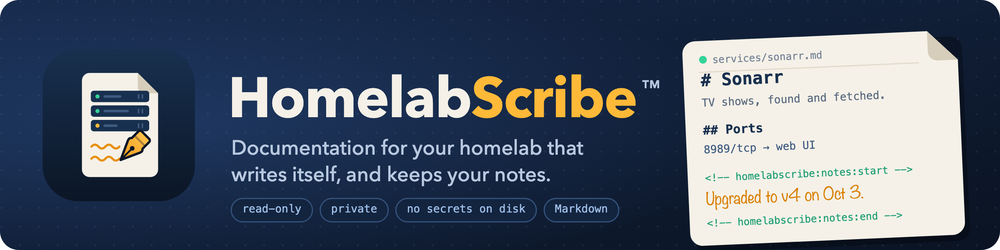

<h1 align="center">
  
</h1>

[](https://github.com/HoneyBearTech/homelabscribe/actions/workflows/ci.yml)
[](https://github.com/HoneyBearTech/homelabscribe/actions/workflows/codeql.yml)
[](https://scorecard.dev/viewer/?uri=github.com/HoneyBearTech/homelabscribe)
<!-- TODO: BP_ID - register at bestpractices.dev after the repo goes public, then uncomment and replace <BP_ID>
[](https://www.bestpractices.dev/projects/<BP_ID>)
[](https://www.bestpractices.dev/projects/<BP_ID>)
-->

**Documentation for your homelab that writes itself, and keeps your notes.**

HomelabScribe™ scans your Docker hosts (and, with Pro, your Proxmox cluster) and writes readable Markdown docs: one page per service, one per host, and an overview. Run it again tomorrow and the docs update themselves, while anything you wrote in a page's **Notes** section stays exactly as you left it.

It drops straight into an Obsidian vault, a Git repo, or any Markdown viewer.

- **Read-only.** It never changes a container or VM.
- **Private.** Runs entirely on your network. No telemetry, no phone-home, ever.
- **No secrets on disk.** Environment variable *values* are never recorded, only names. Labels that look like credentials are dropped.

## Documentation

- [Quick start](docs/quick-start.md) · [Installing](docs/installing.md) · [Upgrading](docs/upgrading.md) · [User guide](docs/user-guide/README.md)
- [Architecture](docs/architecture.md) · [Interfaces](docs/interfaces.md) · [Security](docs/security.md) · [Assurance case](docs/assurance-case.md)
- [Dependencies](docs/dependencies.md) · [Verifying releases](docs/verifying-releases.md) · [Roadmap](docs/roadmap.md) · [Accessibility](docs/accessibility.md)
- [Security policy](SECURITY.md) · [Contributing](CONTRIBUTING.md) · [Governance](GOVERNANCE.md) · [Support](SUPPORT.md) · [Changelog](CHANGELOG.md) · [Code of Conduct](CODE_OF_CONDUCT.md)

## Try it in 10 seconds

No Docker access needed; this renders a made-up homelab with every feature turned on:

```bash
pipx install homelabscribe
homelabscribe demo
```

Then open `homelabscribe-demo/index.md`.

## What you get

```
homelabscribe-docs/
├── index.md            # every host and service, grouped by category
├── hosts/nova.md       # what runs on each machine
├── services/sonarr.md  # ports, storage, networks, dependencies, how to restart, your notes
├── CHANGELOG.md        # Pro: what changed since the last scan
├── break-glass.md      # Pro: a plain-English guide for family if you're unavailable
└── topology.md         # Pro: Mermaid diagram of hosts, services and dependencies
```

HomelabScribe recognizes ~45 common self-hosted apps (the *arr stack, Plex, Pi-hole, Traefik, Home Assistant, Vaultwarden, Grafana and more) and describes them in plain language. Add your own with labels or a catalog file.

## Free vs Pro

| | Free | Pro |
| --- | --- | --- |
| Docker hosts | 1 | Unlimited |
| Proxmox VMs and LXCs | | Yes |
| Service, host and overview pages | Yes | Yes |
| Your notes preserved across runs | Yes | Yes |
| Changelog ("what changed this week") | | Yes |
| Break-glass guide for family | | Yes |
| Topology diagram | | Yes |
| Built-in scheduler (`--every 1d`) | | Yes |

Pro is a one-time or yearly license key, verified **offline**. Get one at _(store link coming soon)_.

## Run it with Docker Compose

HomelabScribe talks to Docker through a [socket proxy](https://github.com/Tecnativa/docker-socket-proxy) so it only ever gets read access.

```bash
mkdir homelabscribe && cd homelabscribe
curl -O https://raw.githubusercontent.com/HoneyBearTech/homelabscribe/main/docker-compose.example.yml
curl -O https://raw.githubusercontent.com/HoneyBearTech/homelabscribe/main/homelabscribe.example.yaml
mv docker-compose.example.yml docker-compose.yml
mkdir config state && mv homelabscribe.example.yaml config/homelabscribe.yaml
sudo chown 1000:1000 state   # or change `user:` in the compose file to match your docs folder's owner
# Point the ./docs volume at your Obsidian vault folder, then:
docker compose run --rm homelabscribe
```

Schedule it with cron (free) or `--every 1d` (Pro).

## Configuration

See [`homelabscribe.example.yaml`](homelabscribe.example.yaml). Values like `${PVE_TOKEN}` are read from the environment.

### Per-container labels

```yaml
labels:
  homelabscribe.name: "Family Photos"
  homelabscribe.description: "Where everyone's phone photos back up to."
  homelabscribe.category: "Photos"
  homelabscribe.url: "https://photos.home.example"
  homelabscribe.hidden: "true"    # leave this container out of the docs
```

### Proxmox (Pro)

Create a read-only API token:

```bash
pveum user add homelabscribe@pve
pveum acl modify / --users homelabscribe@pve --roles PVEAuditor
pveum user token add homelabscribe@pve docs --privsep 0
```

## Your notes are safe

Every page ends with a block like this:

```markdown
<!-- homelabscribe:notes:start -->
Upgraded to v4 on Oct 3; config moved to /opt/sonarr.
<!-- homelabscribe:notes:end -->
```

HomelabScribe rewrites everything else on the page but copies this block forward untouched. If a service disappears and its page has notes, the page is moved to `archive/` instead of deleted.

## Commands

| Command | What it does |
| --- | --- |
| `homelabscribe run` | Scan, then write docs. The usual command. |
| `homelabscribe scan` | Take a snapshot only. |
| `homelabscribe render` | Rewrite docs from the latest snapshot. |
| `homelabscribe doctor` | Check config, connections and license; safe to paste into an issue. |
| `homelabscribe demo` | Render a sample homelab. |

## Development

```bash
python -m venv .venv && . .venv/bin/activate
pip install -e '.[dev]'
pytest && ruff check .
```

See [CONTRIBUTING.md](CONTRIBUTING.md); commits need a DCO sign-off (`git commit -s`).

Architecture: collectors (Docker, Proxmox) → enrichment (app catalog, labels) → JSON snapshot → diff → Jinja2 renderers. Adding a source means writing one collector; see `src/homelabscribe/collectors/`.

## License

The core is [AGPL-3.0](LICENSE). Everything in `src/homelabscribe/pro/` is source-available under the [HomelabScribe Pro License](src/homelabscribe/pro/LICENSE-COMMERCIAL.md) and needs a Pro key to use.

## Trademarks

HomelabScribe™ and its logo are trademarks of HoneyBearTech. The code licenses do not grant rights to the name or logo; see [TRADEMARKS.md](TRADEMARKS.md).
